# CCC Portal

**A Web-Based Integrated Student Information and Campus Services Portal for Calauan Community College**

Midterm project for **COMP 016 Web Development** and **COMP 018 Database Administration**
Polytechnic University of the Philippines, Calauan Campus (BSIT, 3rd year)

Authors: Francheska T. Lanip, Glayza D. Malan

---

## Table of Contents

1. [Overview](#1-overview)
2. [Features by Role](#2-features-by-role)
3. [Tech Stack](#3-tech-stack)
4. [How the System Works](#4-how-the-system-works)
5. [Project Structure](#5-project-structure)
6. [Requirements](#6-requirements)
7. [Installation and Setup](#7-installation-and-setup)
8. [Test Accounts](#8-test-accounts)
9. [Roles and Access](#9-roles-and-access)
10. [Security](#10-security)
11. [Database Design](#11-database-design)
12. [Database Administration](#12-database-administration)
13. [Manual Test Checklist](#13-manual-test-checklist)
14. [Screenshots](#14-screenshots)
15. [Known Limitations](#15-known-limitations)
16. [Troubleshooting](#16-troubleshooting)

---

## 1. Overview

The CCC Portal gives Calauan Community College one place to manage student records and account access.
The registrar enrolls students, the admin manages staff accounts, and every user signs in with the
role that fits them (student, faculty, registrar or admin).

The system has two parts:

- **back-end** (Laravel + PostgreSQL): business rules, authentication, the database, Blade pages and a JSON API.
- **front-end** (React + Vite): a single-page app that talks to the back-end JSON API.

## 2. Features by Role

| Role | What they can do |
|------|------------------|
| **Student** | Sign in with the student number, see own dashboard and own record, change password |
| **Faculty** | Sign in with email, see dashboard, change password |
| **Registrar** | Manage programs, add and edit students, enroll students, open the staff page |
| **Admin** | Everything the registrar can do, plus create and manage user accounts (faculty, registrar, admin) |

Shared features:

- Separate login pages for Student, Faculty and Staff. Staff means registrar and admin. Using the wrong login page shows an error.
- Students sign in with their **student number** (format `CCC-YYYY-NNNN`). Everyone else signs in with **email**.
- Password recovery by email (see below).
- Change password after login.
- The student dashboard shows the student number, name, **email**, program, class, contact number and enrollment status.
- In the React app the side menu is closed after login and opens only when the menu (hamburger) button is pressed.

**Password recovery**

1. The first time a user uses *Forgot password*, the system emails their login credentials (students receive their student number as username). This applies to accounts created by the registrar or admin, who start with a random password nobody knows.
2. The **seeded test accounts** are different: the seeder sets `credentials_sent_at`, so they already count as having credentials and get a **6-digit code** on the very first request.
3. Later requests email a **6-digit code**. The code is stored hashed, expires after 15 minutes, allows 5 attempts and can be used only once.
4. The response is the same whether or not the email exists, so nobody can find out which emails are registered.

## 3. Tech Stack

| Layer | Technology |
|-------|-----------|
| Back-end framework | Laravel 13.34.0 (PHP 8.3.30) |
| Database | PostgreSQL 17 |
| Front-end | React 19.3.1, Vite 8.3.4, react-router-dom 7.18.4, plain CSS |
| Authentication | Laravel session cookie plus CSRF token |
| Development mail | Mailpit (SMTP on port 1025, inbox on port 8025) |

## 4. How the System Works

There are two "front doors" into the same back-end. They share the same models, middleware and database.

```
Browser
  |
  |-- Blade pages   http://localhost:8000   (served directly by Laravel)
  |
  |-- React app     http://localhost:5173   (Vite dev server)
          |
          |  /api/*  (Vite proxy)
          v
      Laravel  http://127.0.0.1:8000
          |
          v
      PostgreSQL (connected as the limited role ccc_app)
```

- The React app calls `/api/...` routes. These routes live in `back-end/routes/web.php` inside `Route::prefix('api')`, so they use the normal session and CSRF protection.
- The React helper `src/csrf.js` (`api()`) first calls `/api/me` to get the `XSRF-TOKEN` cookie, sends it back in the `X-XSRF-TOKEN` header, retries once on a 419 response, and clears the stored user on a 401.
- Vite proxies `/api` to `http://127.0.0.1:8000`, so the browser sees one origin and cookies work.
- Blade controllers and the `Api` controllers are separate, so validation rules must be kept in sync between them.

**Per-request database identity (for row-level security)**
The `SetDatabaseUser` middleware tells PostgreSQL who is logged in (`app.user_id`, `app.role`) on every request. See [section 12.7](#127-row-level-security-rls).

## 5. Project Structure

The project has two folders because it has two parts: the **back-end** (Laravel, with the database) and the **front-end** (React, the screens). The React screens get their data from the back-end.

```
ccc-portal/
|-- README.md
|-- docs/             ERD and screenshots
|-- back-end/         Laravel: login, roles, database, API, Blade pages
|   |-- app/          Controllers, middleware, models
|   |-- database/     Migrations, seeder, roles.sql
|   |-- resources/    Blade pages
|   `-- routes/       web.php (all URLs)
`-- front-end/        React: the screens (login, dashboards, students, ...)
    `-- src/          Pages, Layout.jsx, csrf.js
```

**Main functions we wrote**

| Function | File | Purpose |
|----------|------|---------|
| `login()` | `Api/AuthController` | Validates the login, finds the user (student number or email), checks the password and that the chosen login page matches the role, then starts the session |
| `handle()` | `RoleMiddleware` | Returns 403 unless the user's role is in the route's list |
| `request()` | `PasswordRecovery` | Forgot password step 1: credentials the first time, a 6-digit code after that |
| `reset()` | `PasswordRecovery` | Forgot password step 2: checks the code (expiry, 5 attempts, hash), saves the new password, deletes the code |
| `store()` | `StudentController`, `Api/StudentController` | Validates a new student and creates the user and student record in one transaction |
| `rules()` | `Api/StudentController` | Validation rules for a student: number format `CCC-YYYY-NNNN`, unique number, year level 1 to 6, contact number |
| `enroll()` | `StudentController`, `Api/StudentController` | Sets the enrollment status to Enrolled |
| `destroy()` | `StudentController` | Deletes the user; the student row goes with it (ON DELETE CASCADE) |
| `generatePassword()`, `send()`, `sendCode()` | `Credentials` | Random password, credentials email, code email |
| `asSystem()` | `Rls` | Runs a pre-login lookup with the read-only system role |
| `api()` | `csrf.js` | React helper: CSRF token, one retry on 419, clears the session on 401 |

## 6. Requirements

- PHP 8.3 or newer (with the `pdo_pgsql` extension enabled)
- Composer 2
- Node.js 20 or newer and npm
- PostgreSQL 17 (pgAdmin or `psql` to run SQL)
- Mailpit (to read the password emails in development)
- Git

## 7. Installation and Setup

### 7.1 Get the code

```
git clone https://github.com/FrancheskaLanip/ccc-portal.git
cd ccc-portal
```

### 7.2 Create the database

Open `psql` (or pgAdmin Query Tool) as the `postgres` user:

```sql
CREATE DATABASE ccc_portal;
```

### 7.3 Create the database roles

Run `back-end/database/roles.sql` against the `ccc_portal` database. It creates:

- `ccc_app`: the role the web app uses (SELECT, INSERT, UPDATE, DELETE and sequence use)
- `ccc_readonly`: a read-only role (SELECT only)

Then give `ccc_app` a password of your choice:

```sql
ALTER ROLE ccc_app PASSWORD 'choose-a-password';
```

### 7.4 Back-end setup

```
cd back-end
composer install
copy .env.example .env          (use cp on Mac/Linux)
php artisan key:generate
```

Open `back-end/.env` and fill in:

```
DB_USERNAME=ccc_app
DB_PASSWORD=choose-a-password

DB_ADMIN_USERNAME=postgres
DB_ADMIN_PASSWORD=your-postgres-password
```

Why two database users? The app runs as the limited `ccc_app` so that row-level security is enforced.
Migrations create tables and policies, which needs the owner, so they use the second connection `pgsql_admin`.

Build the tables and test data:

```
php artisan migrate:fresh --seed --database=pgsql_admin
```

> Always add `--database=pgsql_admin` when running migrations or seeding.

### 7.5 Start the mail catcher

Start Mailpit. Emails sent by the portal will appear at http://localhost:8025 (SMTP is on port 1025).

### 7.6 Run the back-end

```
php artisan serve
```

Open http://localhost:8000 to use the Blade version.

### 7.7 Run the front-end

In a second terminal:

```
cd front-end
npm install
npm run dev
```

Open http://localhost:5173 to use the React version. Keep `php artisan serve` running, because the React app needs the API.

## 8. Test Accounts

All seeded accounts use the password `password`. Their first *Forgot password* request sends a 6-digit code (not credentials), and the code sets a new password.

| Role | Login | Tab to use |
|------|-------|-----------|
| Admin | `admin@ccc.test` | Staff login |
| Registrar | `registrar@ccc.test` | Staff login |
| Faculty | `faculty@ccc.test` | Faculty login |
| Student | `CCC-2026-0001` (student number) | Student login |

Students are signed in with the student number, not an email. Change these passwords before any real use.

## 9. Roles and Access

| Area | Student | Faculty | Registrar | Admin |
|------|:------:|:------:|:--------:|:----:|
| Own dashboard | yes | yes | yes | yes |
| Change own password | yes | yes | yes | yes |
| Programs | no | no | yes | yes |
| Students (list, add, edit, enroll) | no | no | yes | yes |
| Staff page (`/staff`) | no | no | yes | yes |
| User accounts (`/users`) | no | no | no | yes |
| Admin page (`/admin`) | no | no | no | yes |

How it is enforced: `RoleMiddleware` (alias `role`) returns **403** when the role is not allowed.

- `role:admin,registrar` protects programs, students, enrollment and `/staff`.
- `role:admin` protects users and `/admin`.
- In React, `Layout.jsx` also redirects a user who opens a page not in their menu back to the dashboard. This is only a convenience. The real block is the 403 from `RoleMiddleware` on the server (visible when you open the Blade URL or call the API directly).

Who creates which account:

- **Registrar** adds a student. This creates the login (a user with role `student`) and the student record together in one database transaction. The password is random and unknown, so the student gets in through *Forgot password*.
- **Admin** creates faculty, registrar and admin accounts.

## 10. Security

| Measure | How |
|---------|-----|
| CSRF protection | Token required on every state-changing request (`@csrf` in Blade forms; `XSRF-TOKEN` cookie and `X-XSRF-TOKEN` header in React) |
| XSS protection | Output is escaped: Blade `{{ }}` and React escape values automatically. We do not use `{!! !!}` or `dangerouslySetInnerHTML` |
| Password hashing | Passwords are stored hashed (bcrypt), never as plain text |
| Role checks | `RoleMiddleware` on every protected route |
| Input validation | Server-side validation in the controllers |
| Mass assignment | Models use `$fillable`. The `role` column is not mass-assignable |
| Brute force | `throttle:6,1` on the password recovery routes |
| No user enumeration | Same response for existing and non-existing emails |
| Reset codes | Hashed, expire in 15 minutes, 5 attempts, single use |
| Database privileges | App runs as `ccc_app` with limited rights (see section 12) |
| Row-level security | PostgreSQL policies on the `students` table |

## 11. Database Design

### 11.1 ER diagram

**ERD generated from the real database (all tables)**

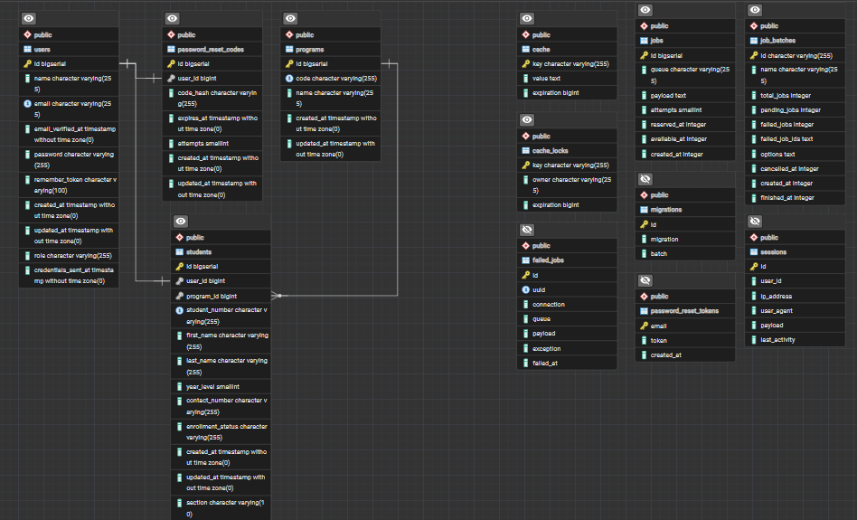

Our tables are `users`, `students`, `programs` and `password_reset_codes`. The other tables (`sessions`, `cache`, `cache_locks`, `jobs`, `job_batches`, `failed_jobs`, `migrations`, `password_reset_tokens`) are default Laravel tables with no relationships to ours.

**Simplified ERD (our tables only)**


The diagram source is in [docs/erd.mmd](docs/erd.mmd) (Mermaid). The same diagram:

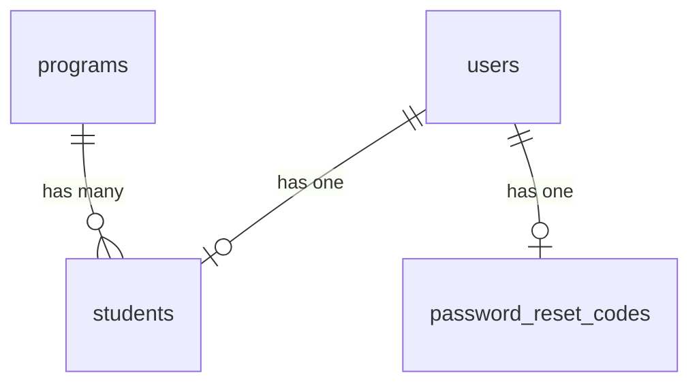

### 11.2 Tables

| Table | Purpose | Main columns |
|-------|---------|--------------|
| `users` | Every login account | `id`, `name`, `email` (unique), `password`, `role` |
| `programs` | Degree programs | `id`, program name/code |
| `students` | Student records | `id`, `user_id`, `program_id`, `student_number` (unique), `last_name`, `section` (nullable), `contact_number` (nullable) |
| `password_reset_codes` | One-time recovery codes | `user_id`, hashed code, expiry, attempts |
| `sessions` | Login sessions (database driver) | managed by Laravel |
| `cache`, `cache_locks`, `jobs`, `job_batches`, `failed_jobs`, `migrations`, `password_reset_tokens` | Default Laravel tables (cache, queue, migration history) | managed by Laravel |

> The full column list is in the migrations under `back-end/database/migrations/`. The migrations are the source of truth.

### 11.3 Keys and relationships

- `users` 1 to 0..1 `students`: a student record belongs to one user account.
- `programs` 1 to 0..* `students`: a program has many students.
- `users` 1 to 0..1 `password_reset_codes`: a user has at most one active code.
- **Surrogate key vs natural key:** every table uses a serial `id` as primary key. `student_number` (`CCC-YYYY-NNNN`) is a **natural key** kept `UNIQUE`. We use `id` for foreign keys because it is short and never changes, while the student number is a business value that could be reformatted.

### 11.4 Normalization

- **1NF:** every column holds one value; no repeating groups.
- **2NF/3NF:** program details live in `programs`, not repeated in every student row; login details live in `users`, not in `students`. Every non-key column depends on its own table's key only.
- `section` and `contact_number` are **nullable** because they may not be known when the registrar first adds a student.

### 11.5 Indexes

Besides the primary keys and unique constraints, these indexes support the most common queries:

- `students.program_id`: filtering and joining students by program.
- `students.last_name`: searching and sorting by last name.

Check that an index is used with `EXPLAIN`:

```sql
EXPLAIN ANALYZE SELECT * FROM students WHERE last_name = 'Lanip';
```

Read the output: `Index Scan using ...` means the index is used; `Seq Scan` means PostgreSQL read the whole table. On a very small table PostgreSQL may still choose `Seq Scan` because it is cheaper, which is normal.

### 11.6 Trigger (data integrity)

Trigger `students_user_role_check` runs the function `check_student_user_role()` before a student row is saved.
It makes sure the linked `users` row has the role `student`, so a faculty or admin account can never be linked to a student record, even if someone bypasses the application.

## 12. Database Administration

### 12.1 Roles and privileges

| Role | Privileges | Used for |
|------|-----------|----------|
| `postgres` | Owner / superuser | Migrations, seeding, backups |
| `ccc_app` | SELECT, INSERT, UPDATE, DELETE on tables, USAGE on sequences | The running web application |
| `ccc_readonly` | SELECT only | Reporting, viewing data safely |

The role script is `back-end/database/roles.sql`. To prove the difference:

```sql
-- as ccc_readonly
SELECT count(*) FROM students;     -- works
DELETE FROM students;              -- ERROR: permission denied for table students
```

### 12.2 Backup

Create a backup with `pg_dump` in custom format. Run it as `postgres`, because a dump made by `ccc_app` would be incomplete (row-level security hides rows from it).

```
pg_dump -U postgres -h localhost -F c -f backups\ccc_portal.dump ccc_portal
```

The backup file stays on your own computer. It is not in the repository, so a groupmate gets the same tables and test data by running `php artisan migrate:fresh --seed --database=pgsql_admin`, or by restoring a dump you send her.

A ready-made Windows script can wrap this command (`backup.bat`). **Do not commit `backup.bat` or the dump to Git**, because the script contains the database password. The `backups/` folder and `backup.bat` are listed in `.gitignore`.

### 12.3 Restore (proof)

Restore into a separate test database to prove the backup works:

```sql
CREATE DATABASE ccc_restore_test;
```

```
pg_restore -U postgres -h localhost -d ccc_restore_test backups\ccc_portal.dump
```

Then compare row counts:

```sql
\c ccc_restore_test
SELECT count(*) FROM students;
SELECT count(*) FROM users;
SELECT count(*) FROM programs;
```

The counts should match the original database.

### 12.4 Laravel connection settings

| Setting | File | Value |
|---------|------|-------|
| Driver | `.env` | `DB_CONNECTION=pgsql` |
| Host and port | `.env` | `127.0.0.1`, `5432` |
| Database | `.env` | `ccc_portal` |
| App user | `.env` | `DB_USERNAME=ccc_app`, `DB_PASSWORD=...` |
| Admin user (migrations only) | `.env` | `DB_ADMIN_USERNAME`, `DB_ADMIN_PASSWORD` |
| Connections | `config/database.php` | `pgsql` (app) and `pgsql_admin` (migrations) |

Quick check from Tinker:

```
php artisan tinker
>>> DB::select('select current_user');     // ccc_app
```

### 12.5 Why two connections

If the app connected as `postgres` (a superuser, which bypasses RLS), row-level security would silently do nothing. Running the app as `ccc_app` makes the policies real. Migrations still need owner rights, so they use `pgsql_admin`.

### 12.6 Important commands

```
php artisan migrate:fresh --seed --database=pgsql_admin   # rebuild everything
php artisan optimize:clear                                 # clear cached config/routes
php artisan route:list                                     # see all routes
```

### 12.7 Row-level security (RLS)

RLS makes PostgreSQL itself decide which rows of `students` a user may see or change, so the rule still holds even if application code has a bug.

The table has RLS enabled with these policies:

| Policy | Applies to | Rule |
|--------|-----------|------|
| `students_staff_all` | role `admin` or `registrar` | Full access (ALL, with check) |
| `students_system_read` | role `system` | SELECT only (used for pre-login lookups) |
| `students_own_row` | a logged-in student | SELECT only the row where `user_id` equals the logged-in user |
| `students_readonly_select` | DB role `ccc_readonly` | SELECT all rows |

**How Laravel passes the identity:**

1. The `SetDatabaseUser` middleware runs on every web request and sets two session variables in PostgreSQL: `app.user_id` and `app.role`.
2. Policies read them with `current_setting('app.user_id', true)` and `current_setting('app.role', true)`.
3. Lookups that happen **before** login (student number to find the account, forgot password) run inside `Rls::asSystem(fn () => ...)`, which temporarily sets the role to `system` (read only) and restores it afterwards.

**What we tested:**

| Who | Result on `students` |
|-----|----------------------|
| Not logged in / faculty | 0 rows |
| Student | Only own row; cannot update, delete or insert other rows |
| Registrar / admin | Full read and write |
| `ccc_readonly` | Read all; delete gives `permission denied` |
| `postgres` (owner) | Bypasses RLS |

Inspect the policies:

```sql
SELECT policyname, cmd, roles, qual FROM pg_policies WHERE tablename = 'students';
```

**Notes and limits:**

- RLS covers the `students` table only. `users`, `sessions` and `password_reset_codes` are used before login, so RLS there would block signing in.
- Foreign-key checks and cascades bypass RLS (normal PostgreSQL behavior).
- The identity comes from the application (session variables), not from one database role per person. This is a common design for web apps.

## 13. Manual Test Checklist

- [ ] Admin signs in on the Staff login and sees the admin pages
- [ ] Registrar signs in on the Staff login; `/admin` and users pages return 403
- [ ] Faculty signs in on the Faculty login; only dashboard and change password work
- [ ] Student signs in with `CCC-2026-0001`; sees only own record
- [ ] Wrong login page (student on the Staff login) shows an error
- [ ] Student dashboard shows the email
- [ ] After login the React side menu is closed and opens with the menu button
- [ ] Wrong password shows an error and does not reveal which part was wrong
- [ ] Registrar adds a student; user row and student row are both created
- [ ] Duplicate student number or email is rejected with a validation message
- [ ] Forgot password for a seeded account emails a 6-digit code on the first request
- [ ] Forgot password for a new student (added by the registrar) emails credentials the first time, visible in Mailpit
- [ ] Forgot password (later requests) emails a 6-digit code; wrong code, expired code and reused code are rejected
- [ ] Same message for an email that does not exist
- [ ] Change password works and the old password stops working
- [ ] `ccc_readonly` can SELECT but cannot DELETE
- [ ] Backup file is created and restores into `ccc_restore_test` with matching counts

## 14. Screenshots

> Image files go in `docs/screenshots/`.

### React app

**Home**

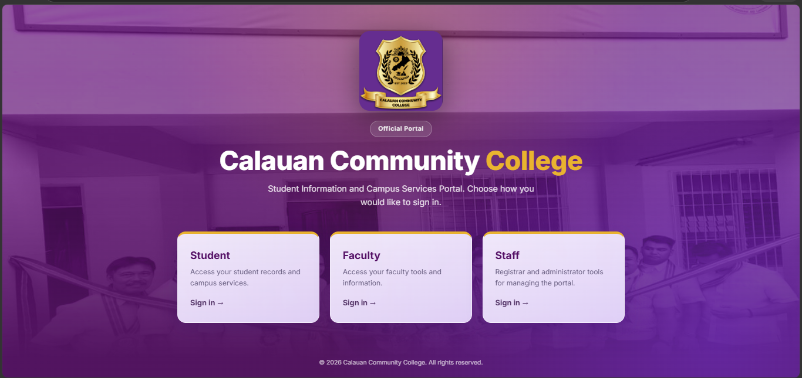

**Student login**

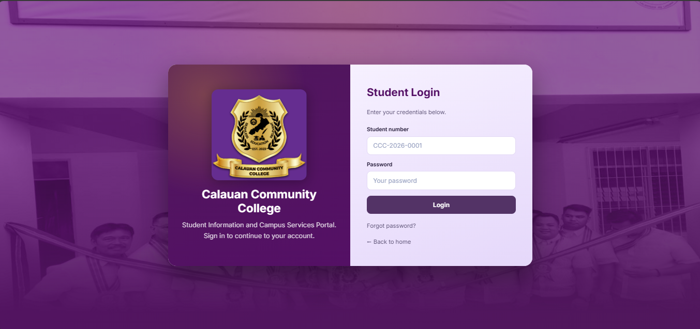

**Faculty login**

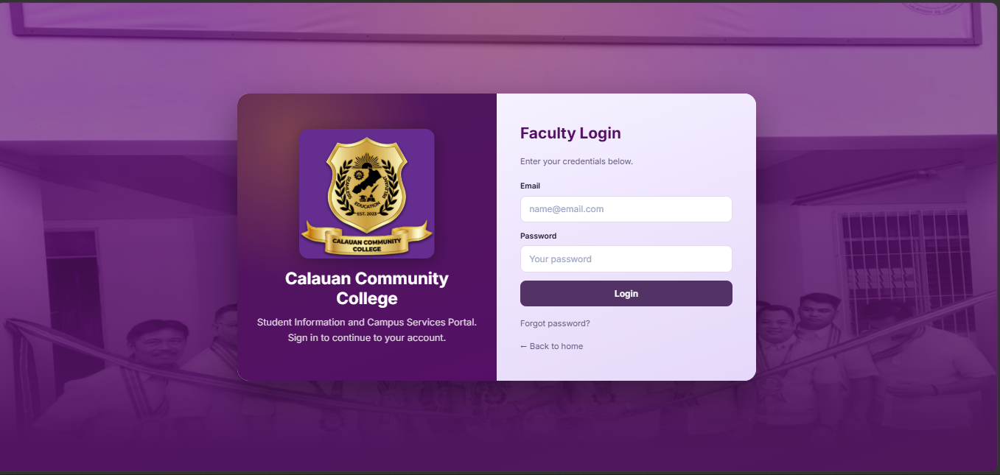

**Staff login**

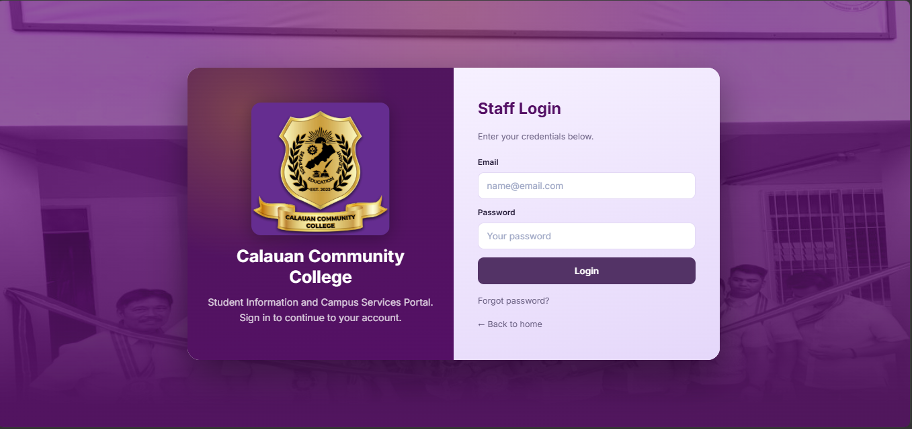

**Forgot password**

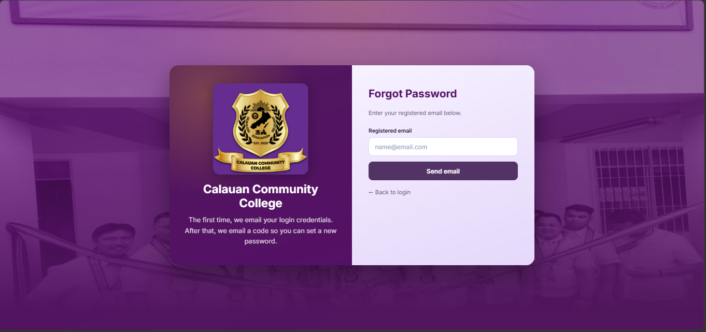

**Reset password**

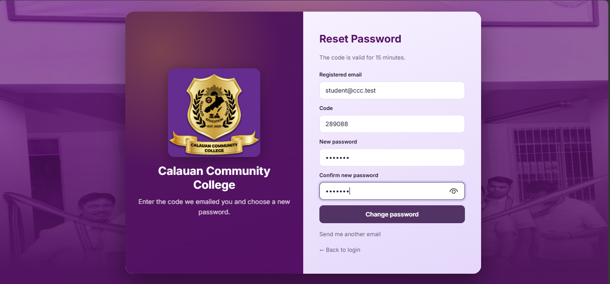

**Student dashboard**

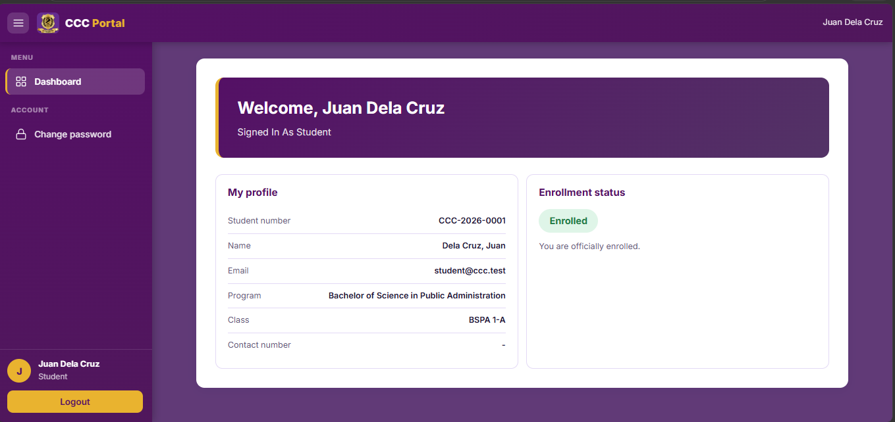

**Registrar dashboard**

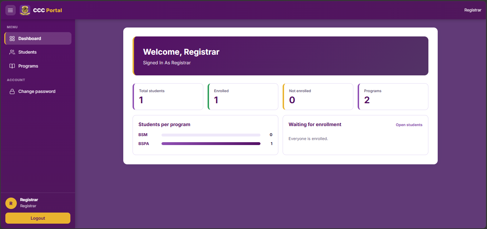

**Admin dashboard**

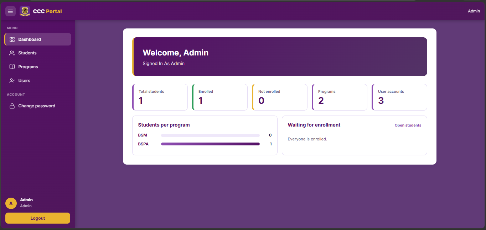

**Faculty dashboard**

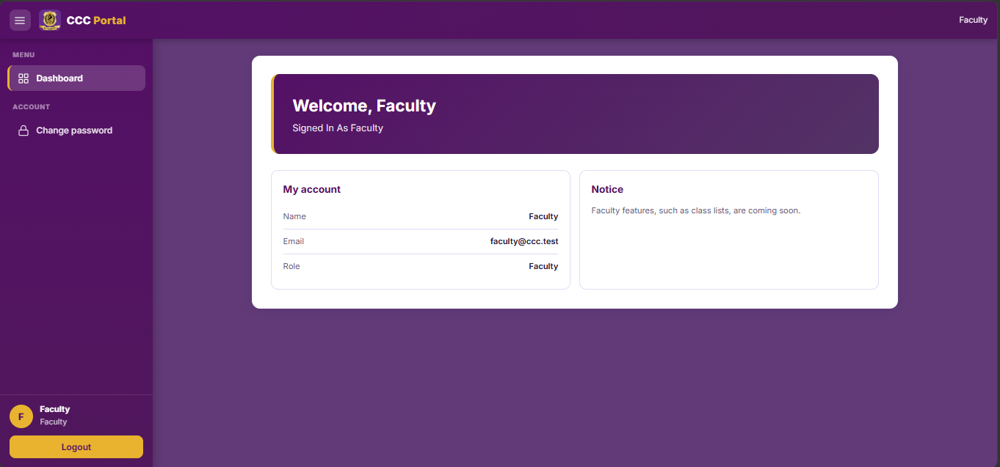

**Students page**

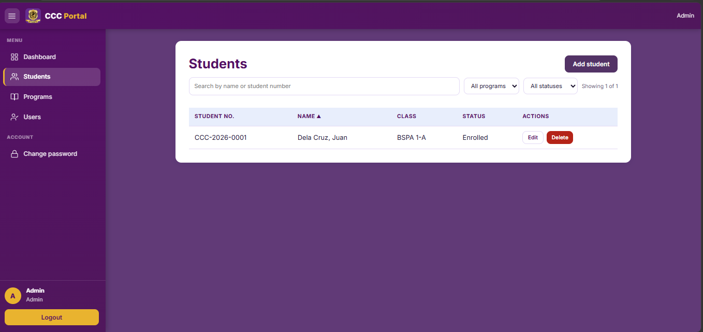

**Programs page**

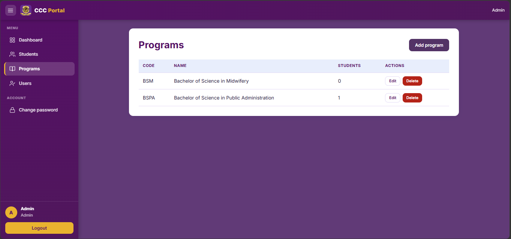

**Users page (admin only)**

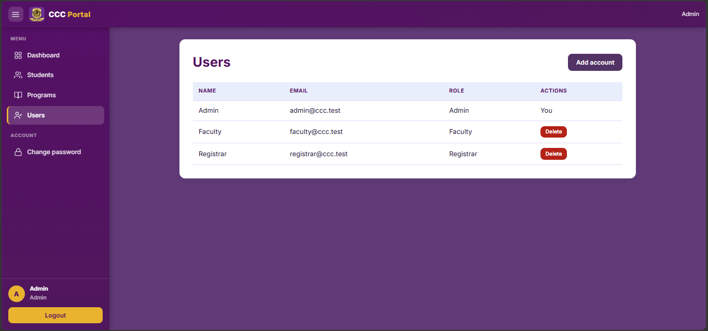

**Change password**

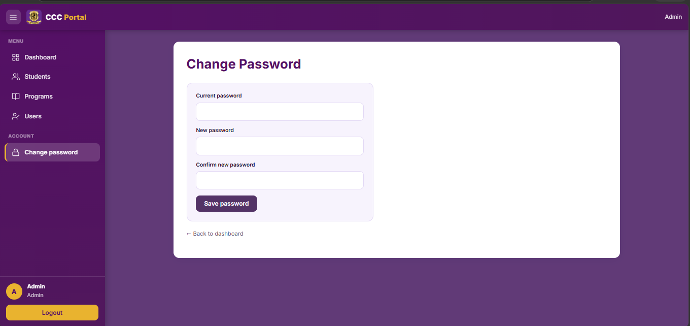

### Database administration

**Table structure: indexes, trigger and RLS (`\d students`)**


**Index check with EXPLAIN ANALYZE**

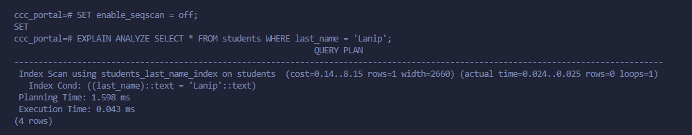

**Trigger blocks a non-student user**

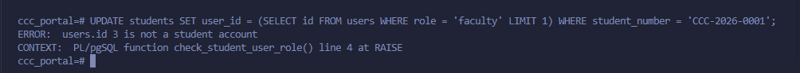

**Read-only role: SELECT works, DELETE denied**

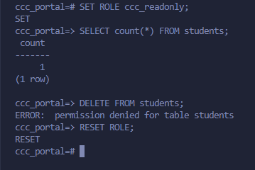

**RLS proof: student sees own row only, staff see all**

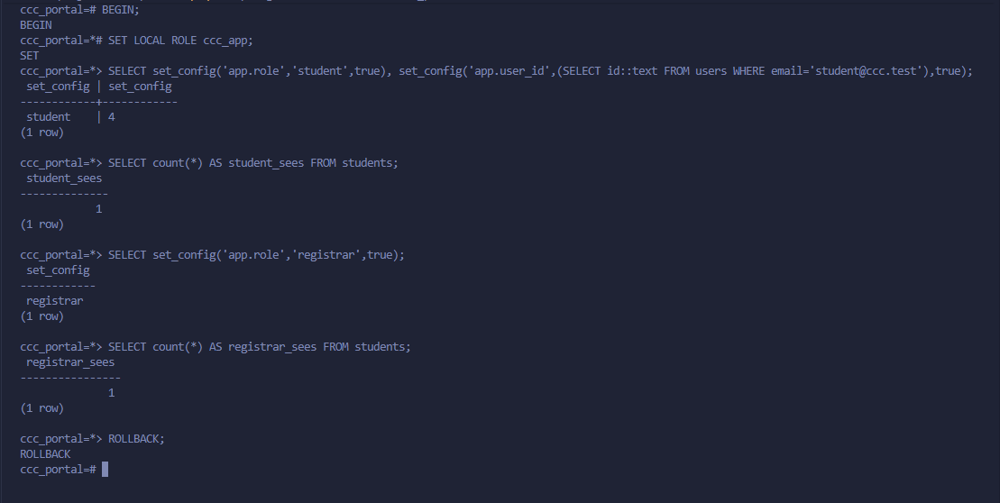

> *Note: The registrar count is 1 here because there is currently only one student in the database. The registrar role bypasses the row-level security policy.*

**Restore proof: matching row counts**

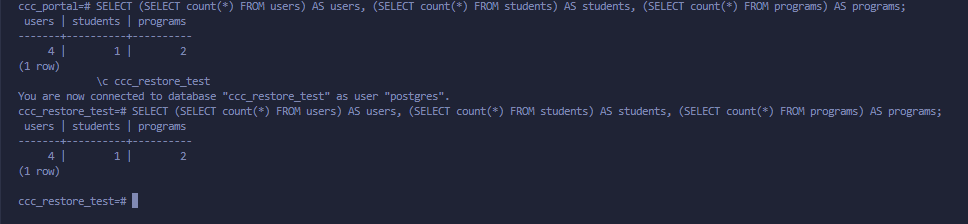

## 15. Known Limitations

- Row-level security is applied to `students` only.
- No helpdesk module yet.
- The faculty role is limited to dashboard and change password.
- There is no public registration page; the registrar creates students.
- Backups are manual (run the script yourself); there is no scheduled backup.
- The Blade form for adding a student may still say credentials "will be sent" to the email, but no email is sent at creation. The student uses *Forgot password* first.
- The RLS identity is passed by the application, not by a separate database role per user.

## 16. Troubleshooting

| Problem | Cause and fix |
|---------|---------------|
| **419 Page Expired** | CSRF token missing or old. Refresh the page; for React make sure `/api` goes through the Vite proxy |
| **`permission denied for table ...`** after migrating | `ccc_app` lacks privileges. Re-run `php artisan migrate:fresh --seed --database=pgsql_admin` (it also grants privileges) |
| **Lists are empty but data exists** | App is not running as `ccc_app` correctly, or the `SetDatabaseUser` middleware is not registered. Check `DB_USERNAME=ccc_app`, the `appendToGroup('web', ...)` line in `bootstrap/app.php`, then `php artisan optimize:clear` |
| **Everything visible even to the wrong role** | The app is connected as `postgres`, which bypasses RLS. Set `DB_USERNAME=ccc_app` |
| **`Class "App\Support\Rls" not found` / middleware not found** | File name typo (for example `SetDatabseUser.php`). Rename it exactly, then `composer dump-autoload` and `php artisan optimize:clear` |
| **React page cannot reach the API** | `php artisan serve` is not running, or port 8000 is used by something else |
| **`npm` errors about `package.json`** | You are in the wrong folder; run npm inside `front-end/` |
| **No email arrives** | Mailpit is not running. Start it and open http://localhost:8025. Check `MAIL_HOST=127.0.0.1` and `MAIL_PORT=1025` |
| **Backup restores with missing rows** | The dump was made as `ccc_app`. Run `pg_dump` as `postgres` |
| **`could not find driver`** | Enable `pdo_pgsql` in `php.ini` |